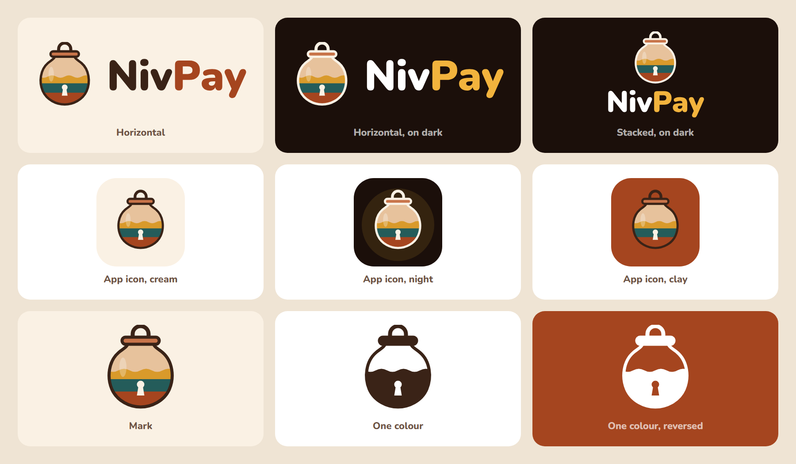

# NivPay logo

The mark is the family's clay pot from the films: three bands of colour, one
per person who put money in, under a wave. The lid's handle is a padlock
shackle and there is a keyhole in front, so the lid is the lock: a pot nobody
can pocket. The wordmark is Nunito Black (SIL Open Font License 1.1),
converted to outlines, so no font is needed to show it.

| File | Use |
| --- | --- |
| `nivpay-logo-horizontal.svg` | the default, on light backgrounds |
| `nivpay-logo-horizontal-on-dark.svg` | on dark backgrounds |
| `nivpay-logo-stacked.svg`, `-on-dark.svg` | square spaces, end cards |
| `nivpay-mark.svg` | the pot alone |
| `nivpay-mark-mono-ink.svg`, `-mono-white.svg` | one colour: stamps, print, watermarks |
| `nivpay-icon-cream.svg`, `-night.svg`, `-clay.svg` | app icons, 512 px tiles |
| `nivpay-wordmark.svg` | the name alone |
| `png/` | the same at fixed sizes, including a 400 px avatar for X |

Colours: ink `#3A2317`, cream `#FAF1E4`, night `#1B0F0A`, pot `#E7C29C`,
lid `#C8744A`, clay `#A5451F`, teal `#245C5A`, saffron `#D99A2B`, gold
`#F2B33D` (Pay on dark). The same palette as the app.

Keep clear space around the mark of at least the lid's width. Don't
recolour the three bands, stretch the mark, or set the wordmark in another
font.

`make-logo.mjs` rebuilds every SVG here. It needs `opentype.js` 1.3.4, which
is not a dependency of the app or the videos: install it in a scratch folder
and run it from there.
